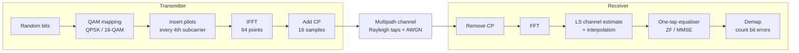
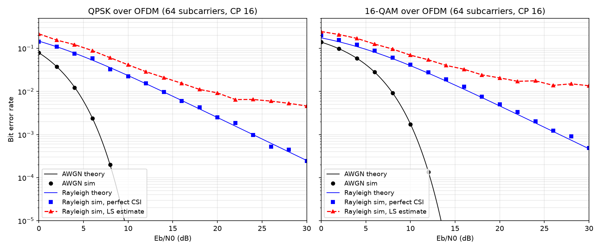
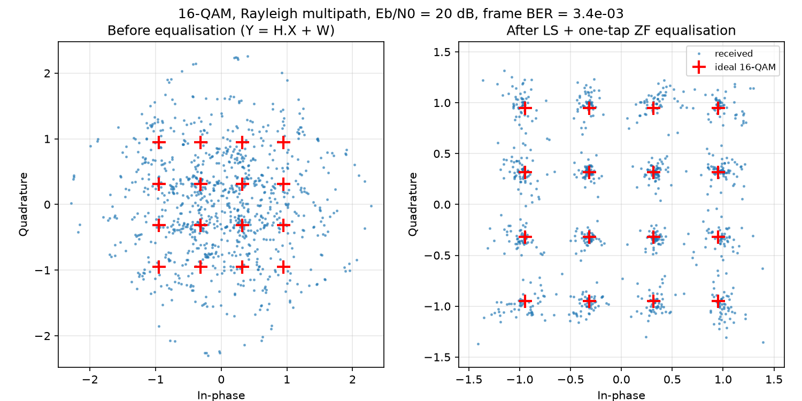
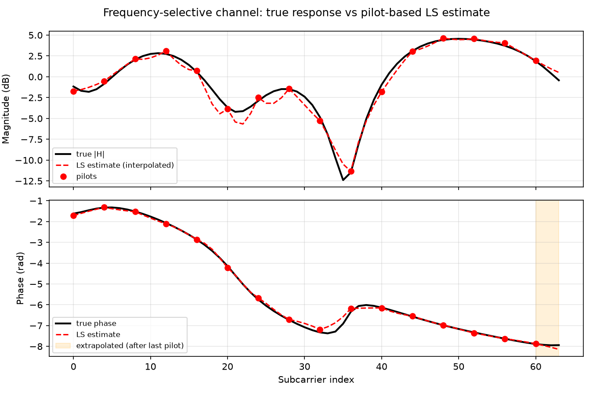
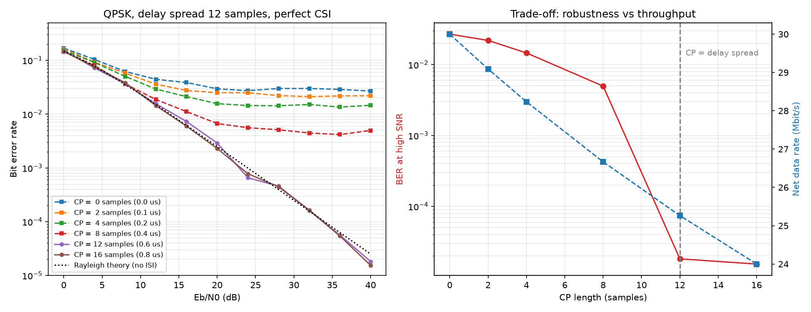
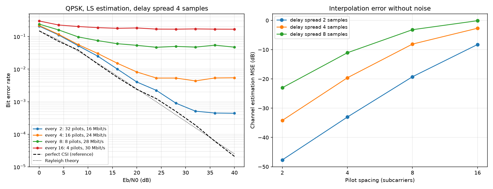

# OFDM Transceiver

End-to-end OFDM link simulation in Python with pilot-based channel estimation and equalisation, validated against theoretical bit error rates.

The project builds the complete physical-layer chain used in Wi-Fi, LTE and 5G NR: QAM mapping, IFFT and cyclic prefix, a multipath fading channel, pilot-based least-squares channel estimation, one-tap equalisation and demapping. It then uses that chain to answer three design questions with measurements:

1. Does the simulated link match theory, and what does estimating the channel cost?
2. What happens when the cyclic prefix is shorter than the channel's delay spread?
3. How many pilots are enough for a frequency-selective channel?

```bash
pip install -r requirements.txt
python main.py        # runs 9 sanity checks, then reproduces every figure (~20 s)
```

---

## Signal chain



The cyclic prefix turns the channel's linear convolution into a circular one. Each subcarrier then sees a single complex gain, `Y[k] = H[k] X[k] + W[k]`, so equalisation is one complex division per subcarrier instead of a long time-domain filter. That property is the reason OFDM is used in every modern broadband standard.

## System parameters

The defaults follow IEEE 802.11a/g (Wi-Fi) numerology, so every number has a real-world reference.

| Parameter | Value | How it is derived |
|---|---|---|
| FFT size / subcarriers | 64 | chosen |
| Data / pilot subcarriers | 48 / 16 | pilot on every 4th subcarrier (comb type) |
| Sample rate (bandwidth) | 20 MHz | chosen |
| Subcarrier spacing | 312.5 kHz | fs / N |
| Useful symbol time | 3.2 us | 1 / spacing |
| Cyclic prefix | 16 samples = 0.8 us | N_cp / fs |
| CP overhead | 20 % | T_cp / (T_u + T_cp) |
| Longest echo path absorbed | 240 m | c * T_cp |
| Net data rate (QPSK / 16-QAM) | 24 / 48 Mbit/s | data subcarriers * bits / symbol time |
| Default channel | 4 Rayleigh taps, 0.2 us max delay, 3 dB per-tap decay | exponential power-delay profile |

All values live in [`ofdm/params.py`](ofdm/params.py); `python -m ofdm.params` prints the table.

---

## Results

### A. BER vs Eb/N0



Simulation points lie on the theoretical curves for both the AWGN channel and the Rayleigh multipath channel with perfect channel knowledge. Multipath costs a lot: QPSK reaches a BER of 1e-5 at about 9.6 dB in AWGN, but only about 2.5e-4 at 30 dB under Rayleigh fading, because some subcarriers always sit in deep fades.

With the channel estimated from pilots (LS and linear interpolation), the curve **flattens into an error floor** instead of just shifting right. The interpolation error does not shrink as noise drops, so extra transmit power stops helping.

| Eb/N0 | AWGN (QPSK) | Rayleigh, perfect CSI | Rayleigh, LS estimate |
|---|---|---|---|
| 10 dB | 4.6e-6 | 2.2e-2 | 4.1e-2 |
| 20 dB | | 2.5e-3 | 9.3e-3 |
| 30 dB | | 2.4e-4 | 4.6e-3 |

### Link visuals



Before equalisation every subcarrier is scaled and rotated by its own channel gain, so the 16-QAM grid is unrecognisable. After the one-tap correction, the points fall back into a clean grid.



The LS estimate follows the true channel closely, except inside the deep fade around subcarrier 35, which falls between two pilots, and after the last pilot (shaded), where the estimate has to be extrapolated. These two regions are where the error floor in Experiment A comes from.

### B. Cyclic prefix length vs delay spread



A channel with echoes up to 12 samples (0.6 us) is simulated with perfect channel knowledge, so the only extra errors come from echoes that spill past the CP and cause inter-symbol and inter-carrier interference.

| CP (samples) | BER at 40 dB | Net rate | CP overhead |
|---|---|---|---|
| 0 | 2.7e-2 | 30.0 Mbit/s | 0 % |
| 4 | 1.5e-2 | 28.2 Mbit/s | 5.9 % |
| 8 | 5.0e-3 | 26.7 Mbit/s | 11.1 % |
| **12** | **1.8e-5** | **25.3 Mbit/s** | **15.8 %** |
| 16 | 1.5e-5 | 24.0 Mbit/s | 20.0 % |

Once the CP covers the delay spread, the BER drops by more than two orders of magnitude and follows Rayleigh theory. A shorter CP creates a floor that no amount of SNR removes. A longer CP than needed only costs throughput. This is why 5G NR offers both a normal and an extended cyclic prefix.

### C. Pilot density



| Pilot spacing | Pilots | Net rate | BER floor at high SNR |
|---|---|---|---|
| 2 | 32 | 16 Mbit/s | 4.4e-4 |
| 4 | 16 | 24 Mbit/s | 5.4e-3 |
| 8 | 8 | 28 Mbit/s | 4.7e-2 |
| 16 | 4 | 30 Mbit/s | 1.7e-1 |

Noise-free channel-estimation error (interpolation error alone):

| Pilot spacing | Delay 2 samples | Delay 4 samples | Delay 8 samples |
|---|---|---|---|
| 2 | -47.7 dB | -34.2 dB | -23.0 dB |
| 4 | -33.0 dB | -19.6 dB | -11.1 dB |
| 8 | -19.3 dB | -8.1 dB | -3.2 dB |
| 16 | -8.2 dB | -2.7 dB | -0.1 dB |

Each doubling of the pilot spacing makes the estimate about 12 to 14 dB worse, and so does each doubling of the delay spread. What matters is the product of the two: pilots must be spaced well inside the channel's coherence bandwidth (roughly N / delay spread subcarriers). Fewer pilots buy throughput at the cost of a higher error floor.

---

## Key findings

| Question | Finding |
|---|---|
| Does the link match theory? | Yes. AWGN and Rayleigh BER agree with closed-form curves for QPSK and 16-QAM. |
| What does channel estimation cost? | With linear interpolation it causes an error floor, not just an SNR penalty. |
| How long must the CP be? | At least the channel delay spread. Below that, BER floors; above it, only throughput is lost. |
| How many pilots? | Enough to keep pilot spacing inside the coherence bandwidth; error grows about 12 to 14 dB per doubling of spacing. |
| What does the overhead cost? | CP and pilots together cost 2.2 dB in Eb/N0 (`ebn0_to_noise_var(..., include_overhead=True)`). |

## Design notes

- **Energy-preserving FFTs.** `np.fft` is used with `norm="ortho"`, so a subcarrier symbol with unit energy produces unit power per time sample, and noise added in time has the same variance per subcarrier after the receiver FFT. This keeps the Eb/N0 bookkeeping exact.
- **Eb/N0 definition.** By default Eb/N0 is defined per data bit on a data subcarrier, so curves can be compared directly with textbook theory. The CP and pilot overhead can be charged to the data bits with `include_overhead=True`.
- **ZF vs MMSE.** Both equalisers are implemented. For a single tap per subcarrier with hard decisions they give identical results once the MMSE amplitude bias is removed (which 16-QAM thresholds require). MMSE makes a real difference for soft decisions (LLRs) and for MIMO, where streams interfere.
- **Monte Carlo averaging.** Every frame draws one random channel. BER points require at least 500 frames as well as 300 errors, so a single deep fade cannot dominate a result.
- **Reproducibility.** Every experiment uses a fixed random seed; `python main.py` gives the same numbers on every run.

## Project structure

```
ofdm-transceiver/
├── main.py                  # checks + all experiments
├── ofdm/
│   ├── params.py            # system and channel parameters, derived values
│   ├── modulation.py        # Gray-coded QPSK / 16-QAM mapping and demapping
│   ├── ofdm.py              # resource grid, IFFT + CP, CP removal + FFT
│   ├── channel.py           # Rayleigh multipath, AWGN, Eb/N0 to noise variance
│   ├── receiver.py          # LS channel estimation, ZF / MMSE equalisers
│   └── link.py              # one-frame simulation, Monte Carlo BER, theory curves
├── experiments/
│   ├── ber_vs_ebn0.py       # Experiment A
│   ├── link_visuals.py      # constellation and channel-estimate plots
│   ├── cp_length.py         # Experiment B
│   └── pilot_density.py     # Experiment C
├── tests/
│   └── check_chain.py       # 9 sanity checks against theory
└── results/                 # generated figures
```

## How to run

```bash
git clone https://github.com/DheerenDD/ofdm-transceiver.git
cd ofdm-transceiver
python3 -m venv .venv && source .venv/bin/activate
pip install -r requirements.txt

python main.py                  # everything
python main.py --only A C       # selected experiments
python main.py --list           # what each experiment does
python -m tests.check_chain     # sanity checks only
python -m ofdm.params           # print the parameter table
```

Requires Python 3.10+ with NumPy, SciPy and Matplotlib.

## Limitations and next steps

- **Perfect synchronisation is assumed.** Next step: add carrier frequency offset and timing offset, show the inter-carrier interference they cause, and correct them with CP correlation or a Schmidl-Cox preamble.
- **Block fading.** The channel is constant within a frame; time-varying (Doppler) channels would need pilots in time as well as frequency.
- **Better channel estimation.** DFT-based or LMMSE estimation would lower the error floor seen in Experiments A and C.
- **Over the air.** The natural next step is running the same chain on a software-defined radio such as a USRP, where real impairments (phase noise, IQ imbalance, PA nonlinearity) appear.

## Related project

[OFDM radar (ISAC)](https://github.com/DheerenDD/ofdm-radar): the same OFDM waveform used for sensing, producing range-Doppler maps from communication frames. Together, the two projects cover both halves of integrated sensing and communication.